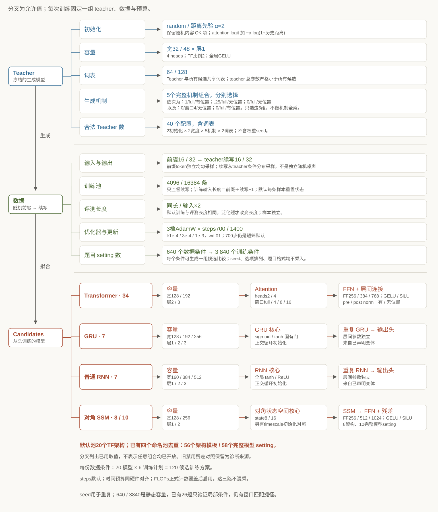
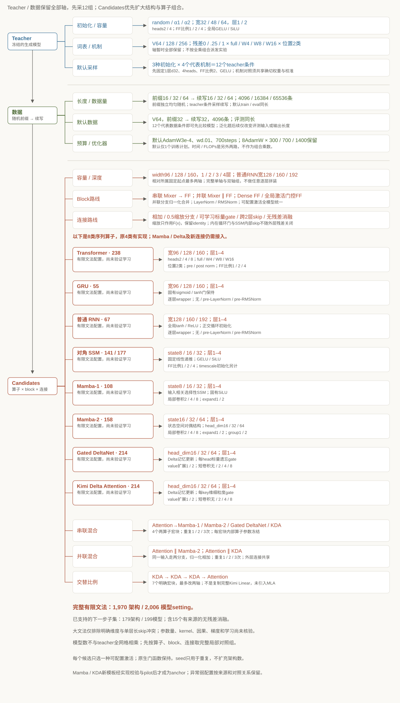

# 当前自由度已能组合，下一步先验证更多机制与局部对照

目前出题器的默认有限池有640个teacher／数据条件，加入3档AdamW和2档steps后为3,840个题目setting。默认候选池有20个正常残差Transformer，已有四个命名池去重后共有56个架构模板、58个含初始化的模型setting。下一步建议保留四个小型起点，完整展开最多两轴的有限邻域，并增加teacher机制、长度和数据量。这份提案在静态约束后有979,776个数据条件、23,514,624个题目setting，以及164个架构模板、184个模型setting。每份固定数据的完整候选训练计划从120增至4,416。现有实测完成1,200次训练、确认26题，70道目录题均待人工review。逐层窗口匹配仍可直接解出全部9道五选一。下一步先分层pilot检验学习、稳定分离与捷径失败条件，再扩量；配置容量不能替代高质量题目产率。

## 两张图区分已有自由度与下一步提案

## 计数先固定词表、数据和训练合同

| 口径 | 当前默认池 | 下一步有限提案 |
|---|---:|---:|
| Teacher配置，含词表 |40|12,096|
| Teacher／数据setting，不含预算 |640|979,776|
| 题目setting＝数据×optimizer×steps |3,840|23,514,624|
| 架构模板，每份固定数据 |20|164|
| 含SSM初始化的模型setting |20|184|
| 每份数据的候选训练计划 |120＝20×3×2|4,416＝184×8×3|
| 题目setting×3实例重复 |11,520|70,543,872|

题目setting是一组比较实验的配置，不能直接视为一道通过质量核验的题。三次teacher／数据seed重复和五次训练seed各自另计。

当前四个命名池的并集为56个架构模板、58个模型setting。图中列出了已出现的取值；它们仍按各profile的显式变体列表采样，不做任意全乘。

## 下一步增加164种架构，初始化变化单独计数

| 家族 | 架构模板 | 含初始化的模型setting |
|---|---:|---:|
| Transformer |99|99|
| GRU |9|9|
| 普通RNN |14|14|
| 对角SSM |42|62|

每个模型只选一种全局activation。所有改动相对所属不可变anchor计数，最多两轴。FF宽度由模型宽度×FF比例派生。原anchor保留context128与hash，任务适配context256。

Teacher原始15,552个组合经最小候选参数门槛过滤，保留12,096个。每teacher配3前缀×3续写×3评测路由×3训练池＝81个数据条件，再配8AdamW×3steps＝24个训练计划。数据前缀保持独立均匀随机，续写保持teacher条件采样。

GPU时间和FLOPs不作为额外乘数。默认700steps继续保留。新长度、模型与数据量先重新校准成本，约10秒仅作为开发参考。RNN／GRU teacher、hybrid、参数共享、逐层例外和soft labels仍需实现，未纳入本次数量。

## 先冻结分层pilot，再判断哪些自由度值得规模化

先按teacher机制、家族与变化轴覆盖anchor、单轴和完整双轴组。开发集核验熵、历史依赖、学习基线与配对分离。把最小参数、窗口匹配、位置匹配及组合规则在训练前登记。跨家族作为整体结构对照，容量变化需显式披露，不能由同steps推定公平计算量。

比较组冻结后，新隐藏测试只确认或拒绝，不换候选或答案。失败、未解决比较和固定排序组保留在分母中。人类先review具体例题，CPU／GPU混用先对新增实现核验实际初值、batch流和数值结果。

来源：[精确计数](ntp-space-counts.json)、[下一步spec](ntp-next-space-spec.json)、[完整proposal](ntp-proposal.html)。
