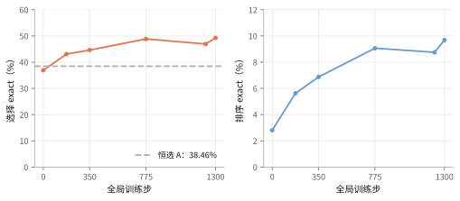
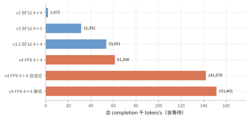

# poor-rl 已开源，可以一起研究模型的强化学习

6,153 道 AIQ（预测模型训练结果的题）已经用于训练 0.8B 模型，任务判断有所改善；希望和同学一起完善训练、评测与思维链分析。

<ul class="settings"><li>模型 <b>Qwen3.5-0.8B</b></li><li>设备 <b>H200</b></li><li>训练题 <b>6,153 道</b></li><li>每题生成 <b>32 条回答</b></li></ul>

## 答案奖励已经能让 0.8B 的任务判断改善

模型读数据描述、候选代码和训练预算，再预测哪个配置训练后成绩更好。poor-rl 是这条实验使用的开源训练框架。它用 vLLM（生成服务）采样回答，用 TRL（强化学习训练库）的异步训练器更新模型。GSPO（按整条回答的平均概率比更新策略）根据同一道题的组内相对奖励更新策略。

生成同题的 32 条回答 → 按答案与格式评分 → 每步用 32 道题更新模型并同步权重 → 在留出题上比较成绩与完整回答。

这条 6k 主线从监督微调模型开始，训练到第 1,300 步。固定留出题上的选择正确率从 36.9% 升到 49.2%，完整排序从 2.8% 升到 9.7%。显式思维链也有变化，但 40 对条件反转题只有一对四次全对，解释仍会误读配置或虚构依据。重复使用的留出题还需要独立确认集验证。[主线结果与真实回答](aiq-rl-pool-b-2026-10-06.html)保留了曲线、配对区间和样本。

这里的更新信号来自答案奖励和回答格式，实验没有提供逐 token 的正确思维链标签。另一条蒸馏后训练线出现过[成绩上涨、解释却失去题目依据](aiq-rl-sft178-2026-10-06.html)的现象。答对和解释可靠性必须分别检查。

## 6k 主线题集已发布为 AIQ-RL v1.0

完整公开 6,153 道训练题和 290 道留出题，包含原始题目、答案、训练实际使用的转换版本、转换脚本和来源清单。版本独立于正式 benchmark v1.5。两边仓库提供同一个题包：[poor-rl 下载](https://github.com/guoshaoyang-pku/poor-rl/releases/tag/aiq-rl-v1.0) · [ArchitectureIQ 官方下载](https://github.com/renrua52/ArchitectureIQ/releases/tag/aiq-rl-v1.0)。

这次发布覆盖本页的 6k 主线。其他历史 RL/SFT 数据、教师回答、模型权重和训练日志不包含在题包中。留出题已用于多轮比较；历史来源的质量门槛和待复审项保留在数据说明中。

## 训练曲线与回答可以直接在页面内查看

[打开网页中的面板](https://guoshaoyang-pku.github.io/blogs/poor-rl-infra-2026-10-06.html#live-panel)。面板通过我的本地电脑转发；电脑关机、睡眠或断网时会断开。曲线与回答来自定期同步到本机的副本，面板中的历史运行标签不代表远端任务当前仍在训练。

## 同学可以从数值对齐、性能测量和回答分析开始开发

当前开发入口是 [poor-rl 仓库](https://github.com/guoshaoyang-pku/poor-rl)。BF16（训练与生成使用的计算精度）主线已合并进 `src/rlforge/`，主参数和优化器保持 FP32（32 位精度）。`production/v3_1/` 保留历史运行源码。下面三项可以独立推进，负责人由参与同学选择。

| 可参与方向 | 代码入口与验收 |
|---|---|
| 训推数值一致性 | 从 [fp8_alignment.py](https://github.com/guoshaoyang-pku/poor-rl/blob/main/src/rlforge/fp8_alignment.py)和[前缀复用验证工具](https://github.com/guoshaoyang-pku/poor-rl/tree/main/tools/prefix_gate)开始。固定权重和 token，对比训练与生成的 logprob，以及复用前后的梯度。按对应配方的门槛保存完整误差分布。 |
| 性能测量与优化 | 从 [prefix_share.py](https://github.com/guoshaoyang-pku/poor-rl/blob/main/src/rlforge/prefix_share.py)和[吞吐测量工具](https://github.com/guoshaoyang-pku/poor-rl/tree/main/tools/bench)开始。固定模型、batch、reward、KL 和卡数，提交包含生成等待、前反向、权重同步的配对测量，先通过数值检查。 |
| 思维链与评测 | 从 [eval_mcq.py](https://github.com/guoshaoyang-pku/poor-rl/blob/main/src/rlforge/eval_mcq.py)和[回答样本查看器](https://github.com/guoshaoyang-pku/poor-rl/blob/main/scripts/home.py)开始。在独立题集上用相同采样条件比较训练前、中期和末期模型。保存原文、答案、解析和截断标记，分别检查答对与解释依据。 |

上手时先读[安装与奖励接口](https://github.com/guoshaoyang-pku/poor-rl/blob/main/docs/QUICKSTART.md)、[AIQ 数据格式](https://github.com/guoshaoyang-pku/poor-rl/tree/main/examples/aiq_mcq)和[H200 配方](https://github.com/guoshaoyang-pku/poor-rl/blob/main/docs/RECIPE_H200.md)。需要查看自己的训练曲线与完整回答时，按[协作面板指南](https://github.com/guoshaoyang-pku/poor-rl/blob/main/docs/PANEL_LINK.md)搭建本机面板。

## 当前低精度实验仍未通过完整生成验证

FP8（实验性的低精度计算）保留 FP32 主参数、梯度和优化器。当前配方在同一题的四条回答上通过了输入阶段的概率对齐，但一个独立逐 token 生成样本的平均 log-ratio 为 0.006154，超过 0.004 门槛。完整生成和长期训练质量仍未验证，见[当前 FP8 配方](https://github.com/guoshaoyang-pku/poor-rl/blob/main/docs/RECIPE_FP8.md)。

## 历史 BF16 测量的主要增益来自并行生成和减少重复计算

总吞吐为实际参加训练的 completion token 总数，除以 step 总墙钟时间，包含等待和权重同步。v0 至 v4 是下面的工程阶段编号。下表从仓库的 <code>INFRA_HISTORY.md</code> 摘取关键阶段；完整行及测量边界见[固定版本原文](https://github.com/guoshaoyang-pku/poor-rl/blob/69a498b9429c6524beda97269f6e49fd98707143/docs/INFRA_HISTORY.md)。

展开各阶段的计时与配置

| 阶段 | 计算 | 训练＋rollout H200 | 计时点 n | 中位秒/步 | 总 token/s | 相对 v1 | 等 rollout |
|---|---|---|---:|---:|---:|---:|---:|
| v0 | FP32 | 4＋4 | 9 | 120.17 | 1,607 | 0.81× | 54.7% |
| v1（近似 TRL baseline） | BF16 | 4＋4 | 17 | 113.80 | 1,972 | 1.00× | 84.9% |
| v2 | BF16 | 4＋2 | 4 | 136.38 | 1,551 | 0.79× | 90.9% |
| v3 | BF16 | 4＋5 | 186 | 61.06 | 31,392 | 15.92× | 1.9% |
| v3.1e | BF16 | 4＋5 | 110 | 65.27 | 30,957 | 15.70× | 1.9% |
| v3.2 | BF16 | 4＋5 | 447 | 36.18 | 53,221 | 26.99× | 7.4% |
| v3.2（4＋4对照） | BF16 | 4＋4 | 17 | 35.57 | 53,691 | 27.23× | 6.4% |
| v4（stride统一） | FP8 | 4＋4 | 17 | 32.23 | 61,268 | 31.07× | 4.1% |
| v4（β=0，4＋4自适应） | FP8 | 4＋4 | 3 | 63.53 | 141,979 | 72.00× | 16.5% |
| v4（β=0，4＋6静态） | FP8 | 4＋6 | 3 | 58.01 | 151,401 | 76.78× | 11.3% |

v0→v1：主参数和优化器保持 FP32，训练改用 BF16 autocast。v2→v3：rollout 从多卡共同承载一个副本改成单卡多副本，复用 prompt 前缀，修复连接超时并调整队列和允许的策略年龄。v3.1：恢复并发 judge、补偿裁判延迟、审计丢弃样本并固定 KL reference。v3.2：加入 fast logprob、token 子批、自适应 activation checkpoint 和 rank 负载均衡。

## FP8 配方同时改变了计算、batch 和调度

v4 在前反向矩阵乘使用 FP8，主参数、梯度累加和 Adam 保持 FP32。修复重复量化编译、更新后缓存不刷新、vLLM（rollout serving 框架）的缓存 dtype 和 backward stride；融合 conv＋SiLU，减少 Norm 中间量。

最后两行每卡真实 microbatch（一次前反向处理的回答数）=1024、GAS（梯度累积次数）=1、global batch=4096，旧对照为 global batch=1024。保留 GSPO、reward 和 Luna judge（抽样检查回答的裁判模型），KL 系数 β=0；原先计算冻结 reference logprob 的两张卡改为 rollout，形成 4＋6。自适应方案按等待、队列和策略年龄调整入场组数，每题仍有 32 条回答。

这两行只统计预先固定的第 4–6 步，每配置一次。相比最强 BF16 的 2.64×、2.82×包含精度、batch、调度、KL 和卡数变化。历史长 run 的 checkpoint、batch、judge 也不同，4＋5 主线另用一张评测卡。高吞吐来自冻结实验配方，未全部集成进主入口，长期学习收益未验证。

## 历史低精度诊断未通过训推一致性门槛

MFU（有用模型计算相对设备峰值的比例）按四张训练卡、含等待估算：BF16 4＋4 约 26.7%，FP8 自适应 4＋4 约 11.2%，4＋6 约 11.8%；后两项纯前反向约 14.4%、14.3%。BF16 用 TRL 通用 FLOPs（浮点运算量）公式，FP8 用捕获算子和共享前缀代理估算，方法与峰值均不同，不能据此判断跨精度 MFU 退化。

当时零更新、同权重同 token 的一个 128-token 样本，trainer−decode logprob 绝对差 P90（90% 样本不超过的值）=0.1214，未过 0.004 门槛；其余两项对照也未通过。诊断 serving 配置与生产不同，仍需全 batch 验证。4＋6 的 GSPO 下侧实际 clip 为 43.84%，上侧为 0.0081%，尚无阈值调整的学习收益证据。

当时 FP8 KV（生成时缓存的低精度注意力状态）、每卡 2,048 条回答的子批和跨独立题组合并未获预期收益。2:4 稀疏和固定 tile Graph 未启用。这些历史测量没有证明当前 FP8 配方或长期训练更好。

来源：[6k 主线数据](aiq-rl-pool-b-2026-10-06-data.json)；poor-rl [当前 H200 配方](https://github.com/guoshaoyang-pku/poor-rl/blob/1545ead467ef3309f4a3aa4f98646a913b7693d3/docs/RECIPE_H200.md)与[当前 FP8 配方](https://github.com/guoshaoyang-pku/poor-rl/blob/1545ead467ef3309f4a3aa4f98646a913b7693d3/docs/RECIPE_FP8.md)，核对于 2026-10-13；历史图表保留 2026-10-06 的 [固定原文](https://github.com/guoshaoyang-pku/poor-rl/blob/69a498b9429c6524beda97269f6e49fd98707143/docs/INFRA_HISTORY.md)与[测量窗口](poor-rl-infra-2026-10-06-data.json)。
